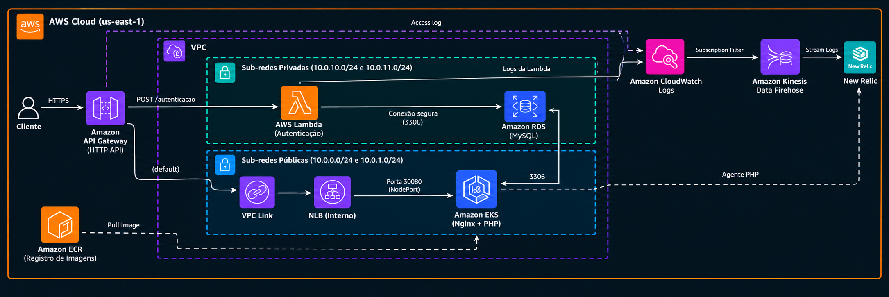

# tech-challenge-infra-k8s

Infraestrutura base do Tech Challenge na AWS: rede, cluster Kubernetes (EKS), registro de imagens, borda pública (API Gateway) e observabilidade (New Relic).

É o **primeiro** repositório a subir e o **último** a ser destruído: os outros três dependem da rede e do cluster criados aqui.

| Repositório | Papel |
|---|---|
| **tech-challenge-infra-k8s** (este) | VPC, EKS, ECR, API Gateway, New Relic |
| [tech-challenge-infra-db](https://github.com/oesleik/tech-challenge-infra-db) | Amazon RDS MySQL |
| [tech-chalange](https://github.com/oesleik/tech-chalange) | Aplicação PHP (Helm no EKS) |
| [tech-challenge-lambda](https://github.com/oesleik/tech-challenge-lambda) | Lambda de autenticação (`POST /autenticacao`) |

## Tecnologias

- Terraform (providers `aws`, `newrelic`, `time`), com state remoto no S3 e lock no DynamoDB
- Amazon VPC, EKS (managed node group), ECR, NLB interno, API Gateway HTTP API com VPC Link
- AWS Systems Manager Parameter Store (contrato entre repositórios)
- Helm: `metrics-server` (HPA) e `nri-bundle` do New Relic
- New Relic: integração AWS (polling), logs via Kinesis Data Firehose, dashboard, synthetic e alertas
- GitHub Actions com OIDC (sem chave de acesso AWS)

## Arquitetura



O diagrama mostra a solução inteira. Este repositório cria a VPC e as sub-redes, o API Gateway com VPC Link, o NLB interno, o EKS, o ECR e o pipeline de logs (CloudWatch → Firehose → New Relic). Lambda e RDS vêm dos repositórios [lambda](https://github.com/oesleik/tech-challenge-lambda) e [infra-db](https://github.com/oesleik/tech-challenge-infra-db), e os pods Nginx + PHP do [tech-chalange](https://github.com/oesleik/tech-chalange). Os outros repositórios encontram esses recursos pelo [contrato SSM](#contrato-publicado-ssm).

Segurança de rede: o NodePort `30080` só aceita o SG do NLB, e o NLB só aceita o SG do VPC Link. A única entrada pública é o API Gateway.

## Contrato publicado (SSM)

Ao final do apply, o Terraform publica em `/tech-challenge/` os valores que os outros repositórios consomem ([`terraform/ssm.tf`](terraform/ssm.tf)). Renomear ou remover um parâmetro **quebra os consumidores**, então trate como mudança de contrato.

| Parâmetro | Consumido por |
|---|---|
| `network/vpc_id` | infra-db, lambda |
| `network/private_subnet_ids` (separados por vírgula) | infra-db, lambda |
| `network/public_subnet_ids` (separados por vírgula) | — (informativo) |
| `eks/cluster_name` | app (kubeconfig) |
| `eks/cluster_security_group_id` | infra-db (ingress do RDS) |
| `ecr/php_repository_url` | app (push da imagem) |
| `apigw/api_id`, `apigw/execution_arn`, `apigw/invoke_url` | lambda (rota e permissão de invocação) |
| `observability/firehose_arn`, `observability/logs_role_arn` | lambda (logs no New Relic). Só existe com o New Relic ligado |

## Pré-requisitos

Setup manual, feito uma vez por conta: bucket do state, tabela de lock e role OIDC `tech-challenge-gha-apply`. Ver [runbook AWS](https://github.com/oesleik/tech-chalange/blob/master/docs/infrastructure/runbook_aws.md).

### Variables do GitHub Actions

| Variable | Uso |
|---|---|
| `AWS_ROLE_ARN_APPLY` | Role OIDC de deploy/destroy |
| `TF_STATE_BUCKET` | Bucket S3 do state |
| `TF_STATE_LOCK_TABLE` | Tabela DynamoDB de lock |
| `EKS_ADMIN_PRINCIPAL_ARNS` | (opcional) JSON com ARNs IAM com admin no cluster |
| `NEW_RELIC_REGION` | (opcional) `US` (padrão) ou `EU` |
| `NEW_RELIC_ALERT_EMAILS` | (opcional) e-mails dos alertas, separados por vírgula |

### Secrets do GitHub Actions

| Secret | Uso |
|---|---|
| `NEW_RELIC_ACCOUNT_ID` | Conta New Relic (integração AWS, dashboard, alertas) |
| `NEW_RELIC_API_KEY` | User API key (`NRAK-...`) do provider Terraform |
| `NEW_RELIC_LICENSE_KEY` | License key: Firehose e Secret do `nri-bundle` |

## Deploy

Pelo GitHub: **Actions → Deploy → Run workflow** (branch `master`, escolha o tipo de instância dos nós). O workflow:

1. Roda `terraform plan` e `apply` (state `tech-challenge/infra-k8s.tfstate`).
2. Instala o `metrics-server` e o `nri-bundle` no cluster.
3. Mostra a URL do API Gateway e os parâmetros SSM no summary.

Próximo passo da cadeia: **Deploy** do [tech-challenge-infra-db](https://github.com/oesleik/tech-challenge-infra-db).

### Ordem entre repositórios

```
Deploy:  infra-k8s → infra-db → app → lambda
Destroy: lambda → app → infra-db → infra-k8s
```

O **Destroy** deste repositório se recusa a rodar enquanto existirem parâmetros em `/tech-challenge/{db,app,lambda}`, ou seja, enquanto algum dependente ainda estiver de pé.

### Execução local (opcional)

Com credenciais AWS que tenham as mesmas permissões da role de apply:

```bash
cd terraform
terraform init \
  -backend-config="bucket=<TF_STATE_BUCKET>" \
  -backend-config="key=tech-challenge/infra-k8s.tfstate" \
  -backend-config="region=us-east-1" \
  -backend-config="dynamodb_table=<TF_STATE_LOCK_TABLE>"
terraform plan -var-file=env/aws.tfvars
```

## CI

[`ci.yml`](.github/workflows/ci.yml) roda em PR e em push na `master`: `terraform fmt -check`, `init -backend=false` e `validate`. É só validação estática: não assume role na AWS nem lê o state.

## APIs

Este repositório não expõe API própria. A URL pública (`api_gateway_url`) é a entrada das APIs documentadas no [tech-chalange (Swagger)](https://github.com/oesleik/tech-chalange#-acessos) e no [tech-challenge-lambda](https://github.com/oesleik/tech-challenge-lambda#api).
